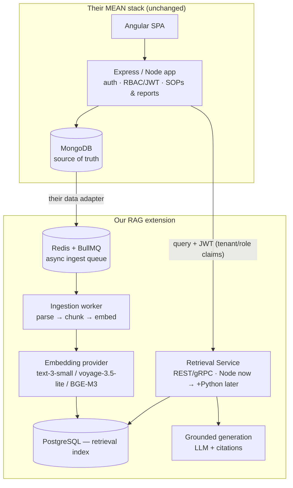

# Final Base Architecture — Postgres-Native RAG System

**Decision:** Postgres is added **alongside** MongoDB, not instead of it. Their MEAN stack (Angular / Express / Node / **MongoDB**) is untouched and remains the system of record. Our RAG subsystem is a **Postgres-backed retrieval index that plugs into their app as an extension** — Postgres holds only *derived, rebuildable* data (chunks + embeddings + retrieval metadata). The RAG is embedded directly into their application, so it must be compatible with their existing auth, tenant model, and data. This supersedes the earlier MongoDB-only blueprint.

**Two-store split (the mental model):**
- **MongoDB = source of truth** — app data, users, and the actual SOPs/reports. Nothing about this changes.
- **Postgres = retrieval index** — a searchable projection of that content. If it's ever lost, we rebuild it from Mongo. It never becomes a second source of truth.

**The insight this rests on:** we use Postgres' **mature** components — `pgvector` + full-text + SQL — *not* the alpha extensions. That gives one-database simplicity and lowest cost with zero maturity risk. `pgContext`/`pgGraph` are kept as an optional side-spike, never on the critical path.

---

## 1. Why Postgres-native (mature subset) is the base

| Requirement | How the base meets it |
|---|---|
| Multi-tenant, high concurrency | **Row-Level Security** keyed to JWT `tenant_id` — the filter is enforced in the database, not app code. Cleanest tenancy story of any option. |
| Verdict-heavy, auditable answers | **SQL** gives exact, provable counts/filters ("how many lots rejected by vendor X") — critical for a compliance/inspection domain. |
| Good embeddings, cost-conscious | `pgvector` is embedding-model-agnostic; one database to run = lowest ops cost. Embeddings are the cheap part (see §4). |
| Structured/hierarchical SOPs | `Section → Question → Answer` tree handled with **recursive CTEs** — no graph engine needed at this depth. |
| Future multimodal | `pgvector` stores *any* embedding, including multimodal ones; the Python service seam (§7) handles media. Additive, not a rewrite. |
| Low risk | Every component is battle-tested. No bet on sub-1.0 software. |

**Versus the alternatives:** a dedicated vector DB (Qdrant) adds a second database + sync complexity + cost, and only pays off at billions-of-vectors scale we won't hit with a report/SOP corpus. pgContext/pgGraph are architecturally elegant but alpha. The mature Postgres subset beats both for a *base*.

---

## 2. Stack & integration with the MEAN app



**How it embeds into their app (compatibility is the whole point):**

- **Delivered as a service, not a database they operate.** Their Express app calls our **Retrieval Service** over **REST/JSON** (with a thin Node client SDK), deployed **same-VPC/same-cluster** so it sits inside their security boundary. REST over gRPC because it's the least-friction fit for a Node/Express caller and easiest to debug; gRPC can be added later if latency ever demands it. To their developers it looks like one more internal API — no Postgres knowledge required. The Retrieval Service is the *only* thing that touches Postgres.
- **Auth is theirs, reused.** The app forwards its existing **JWT** on every RAG call; our service validates the same token and maps its claims onto Postgres **Row-Level Security** — same visibility in RAG as in the app, no second permission system. **JWT claim contract we need** (my recommendation, since it was left to us): `sub` (user id), `tenant_id`, `roles[]`, and scope claims `sites[]` / `vendors[]` for row filtering. If their token already carries these (even under different names), we map them in a tiny adapter — no change to their auth.
- **IDs line up.** Every chunk stores the source Mongo `_id` (`sop_id` = Mongo document id) and `tenant_id`, so a retrieval result links straight back to the live record in their app.
- **Store-agnostic seam.** The app never touches Postgres directly; it calls the Retrieval Service interface. That's what lets the Python multimodal service slot in behind it later with no app-layer change.

---

## 3. Data model (Postgres = derived index only)

Postgres holds only what retrieval needs — it does **not** duplicate the authoritative record (that stays in Mongo). Every row references its Mongo source by `_id`.

| Table | Purpose | Key columns |
|---|---|---|
| `chunks` | retrievable units (vector + text) | `embedding vector`, `text tsvector`, `tenant_id`, **`sop_id` = Mongo `_id`**, `section_path`, `question`, `verdict`, `site`, `vendor`, `po`, `date`, **`modality`**, `embed_model`, `embed_version` |
| `documents` | lightweight projection for hierarchy/CTE traversal (not the source record) | `tenant_id`, `mongo_id`, `type`, `title`, `status`, hierarchy path |
| `audit` | query + access log (compliance) | `tenant_id`, user, query, retrieved ids, ts |

Users/roles/entitlements stay in their app — we don't copy them; we read `tenant_id` + role from the forwarded JWT (see §2).

**Three non-negotiables from day one (the expensive-to-change decisions):**
1. **`tenant_id` on every row** + an **RLS policy** on every table → hard isolation later is a config change, not re-ingestion.
2. **`modality` column** (`'text'` now) → image/video/transcript chunks drop into the *same* table later and unify at retrieval.
3. **`embed_model` + `embed_version`** → a model upgrade is a controlled re-embed, not a mystery (embeddings from different models can't be mixed in one index).

---

## 4. Models — open-source, non-Chinese, self-hosted

**Constraint (per client):** every model is **open-source and self-hosted**, and **no Chinese models**. This keeps sensitive utility-inspection data entirely inside their infrastructure (a data-residency win, and it answers the earlier data-residency question outright) and rules out both proprietary APIs (OpenAI, Voyage) *and* the strong Chinese open models (BGE, GTE, Qwen, etc.).

**Retrieval = hybrid, always.** `pgvector` (semantic) + Postgres full-text `tsvector`/`ts_rank` (BM25 keyword, in-engine), fused with **reciprocal-rank fusion in SQL** — the direct `pgvector + pg_search` equivalent, one database.

| Role | Recommended (open-source, non-Chinese) | Why |
|---|---|---|
| **Embeddings** | **`nomic-embed-text-v1.5`** (Nomic, US · Apache-2.0 · 8192-token ctx) | long context suits SOP chunk + its section; strong retrieval; small/cheap to run |
| alternatives | `mxbai-embed-large-v1` (Mixedbread, DE), `snowflake-arctic-embed-l-v2.0` (US), `e5-large-v2` (Microsoft) | all Apache/MIT, top-tier, non-Chinese |
| **Reranker** (optional — add only if precision needs it) | `mxbai-rerank-large-v1` (Mixedbread, DE) | non-Chinese; avoid `bge-reranker` (Chinese) |
| **Generation LLM** | **Mistral / Mixtral** (Mistral AI, FR · Apache-2.0) or **Llama 3.3 70B** (Meta, US) | strong grounded generation, clean licensing, self-hostable |
| **avoid** | BGE, GTE, Qwen, Yi, DeepSeek, GLM | all Chinese — excluded per constraint |

**Cost & ops shift:** self-hosting means **no per-token API bill and no data leaving their infra** — the cost moves to **inference compute**. Embedding + reranker models are small (a modest GPU, or CPU at low volume). The **generation LLM is the real infra cost**: a 70B model needs GPU(s); a smaller Mistral model is cheaper to run and, with strong hybrid retrieval feeding it, is often enough. Size this against their volume (open question #3).

**Chunking:** structure-aware, preserving `Section → Question → Answer`; store the path in `section_path`; small precise chunks for matching + pull the parent section for generation context. Store `embed_model` + `embed_version` so a model change is a controlled re-embed.

---

## 5. Ingestion & keeping the index in sync with Mongo

Mongo stays the source of truth. The client already has a **data-transfer adapter** that moves source content to us, so ingestion is fed by that adapter — we don't watch Mongo ourselves:

```
Their adapter (create/update/delete events) → our ingest API
   → queue (BullMQ/Redis)
   → worker: parse → structure-aware chunk
     → tag metadata (tenant_id, sop_id=Mongo _id, section_path, verdict, modality)
     → embed → upsert chunks into Postgres
```

- **Source parser:** the inspection reports are **consistently structured spreadsheets** (the `demo_data` sample confirms a fixed 5-sheet `Section → Title → Answer` template), so parsing is **deterministic — no OCR needed**. If the SOP library later adds PDFs/scans, that parser branch is added then.
- **Consistency that matters for compliance:** the adapter must forward **updates and deletes**, not just creates — on those, the corresponding chunks are re-ingested or **removed** from Postgres, so a withdrawn/revised report can never surface in retrieval. `sop_id` + `embed_version` make this a targeted upsert, not a full rebuild. *(This is the one thing to confirm the adapter supports.)*
- **Rebuildable by design:** the whole Postgres index can be regenerated from source at any time (new embedding model, schema change, disaster recovery) — it never holds anything not derivable from Mongo.
- Scales horizontally by adding workers, independently of the query tier. The parse→chunk→tag stage is modality-agnostic by contract, so a media branch is an addition later.

---

## 6. Multi-tenancy & scale

**Tenancy — shared store + RLS (locked; no per-tenant databases per client decision):**
- **Single shared Postgres** for all tenants. `tenant_id` on every row, **RLS policy** keyed to JWT claims injects the tenant filter at the database layer — a missed `WHERE` in app code can never leak data.
- **Defense in depth:** the Retrieval Service also stamps `tenant_id` onto every query independently, so isolation holds even if a token is malformed.
- **If stronger isolation is ever required,** the ceiling is **schema-per-tenant within the same cluster** — never a separate database. RLS on a shared store is the plan of record.

**Concurrency / continuous high load:**
- `pgvector` **HNSW** indexes for fast ANN under load.
- **PgBouncer** connection pooling; **read replicas** to scale query throughput separately from writes.
- **Partition/shard by `tenant_id`** as the corpus grows.
- **Redis** cache for hot queries.
- Per-tenant **rate limiting + token metering** at the app layer.
- Ingestion queue backpressure so ingestion spikes never degrade query latency.
- *Escape hatch:* if `pgvector` ever hits a scale ceiling, a dedicated vector DB can be added behind the same Retrieval Service interface — the shared ingestion pipeline makes it swappable. Not needed at expected volumes.

---

## 7. Future multimodal seam (why later is easy)

| Concern | Reserved now | Added later |
|---|---|---|
| Storage | `modality` column, `pgvector` holds any embedding | image/video/transcript rows in same table |
| Embeddings | provider abstraction | swap to a multimodal model (e.g. `voyage-multimodal-3`) |
| Compute | Retrieval Service *interface* | Python/FastAPI service behind it for keyframing, OCR, transcription |
| Retrieval | hybrid + RLS already modality-blind | queries span text + media, no rewrite |
| App layer | calls the interface | unchanged |

---

## 8. Where pgContext / pgGraph fit

Not in the base — **as an optional side-spike.** Because the mature stack (`pgvector` + full-text + recursive CTEs) already covers hybrid search and the shallow hierarchy, we can trial pgContext (single-engine hybrid) and pgGraph (deep relationship traversal) *in parallel* against real data, and adopt them only if they clearly beat the baseline. Keeping `pgvector` live as the fallback is how we de-risk the interest in those tools without betting the foundation on alpha software.

---

## 9. Build phases

| Phase | Scope | Outcome |
|---|---|---|
| **1 — Foundation** ✅ **BUILT & VERIFIED** | Postgres schema with `tenant_id`/`modality`/`embed_version`; RLS (enabled+forced, fails closed); adapter-fed ingest queue; Retrieval Service API + JWT passthrough; hybrid retrieval (pgvector + full-text, RRF); self-hosted embeddings; citations back to source `_id` | Working multi-tenant text RAG — tested end-to-end (11 reports → 504 chunks; RLS isolation proven at DB + API; grounded cited answers via Mistral) |
| **2 — Scale hardening** ✅ **BUILT & VERIFIED** | PgBouncer (transaction pooling); tenant-scoped Redis query cache + invalidation-on-ingest; automated RLS test suite (5/5, runs on every build); per-tenant rate limiting (429) + usage/token metering (`GET /usage`); read/write split with streaming read replica (reads→replica, writes→primary, RLS on both). *Deferred: table partitioning — premature at current scale (destructive, no benefit yet).* | Production concurrency + continuous use — all tested live |
| **3 — Isolation hardening** ✅ **BUILT & VERIFIED** | Explicit per-query `tenant_id` predicate (defense-in-depth atop RLS); startup self-check (refuses to boot as superuser or if RLS not enabled+forced); JWT hardening (HS256 allowlist — kills `alg:none`, rejects expired/tenant-less tokens); adversarial test suite (11/11 pass). *(schema-per-tenant only if ever needed — never separate DBs.)* | Audit-grade multi-tenancy — tested live (forged/expired tokens → 401; superuser boot → fail-fast exit 1) |
| **A-Completion — finish Legs 1 & 2** 🔨 **IN PROGRESS** | Conversation memory (multi-turn) · verification/anti-hallucination step · graceful fallback · multi-format ingestion (PDF/TXT/SOP trees) · prose chunking + parent-context retrieval · reranker · citation polish · eval harness. **Blocks Phase 4.** See [Pending_Tasks_and_Client_Questions.md](Pending_Tasks_and_Client_Questions.md) | Phase A POC actually complete & acceptance-ready |
| **4 — Multimodal** | Python service behind the retrieval interface; multimodal embeddings; media ingestion | Text + media unified retrieval |
| **(parallel)** | pgContext / pgGraph spike vs. the mature baseline | Adopt only if they win on real data |

---

## 10. Status of the open questions

**Resolved with the client:**
- ✅ **Models** — open-source, non-Chinese, self-hosted (§4). Answers embedding choice, generation LLM, and data-residency in one stroke.
- ✅ **Tenancy** — shared store + RLS, **no per-tenant databases** (§6).
- ✅ **SOP format** — consistently structured spreadsheets (the `demo_data` sample); deterministic parsing, no OCR (§5).
- ✅ **Sync** — fed by their existing **data-transfer adapter** (§5).
- ✅ **Integration surface / JWT** — REST/JSON, same-VPC, with the claim contract we defined (§2).

**Assumed for now (best-case, moderate scale — revise when real numbers arrive):**
1. **Volume & concurrency** — ~50 tenants, ~5–20k docs/tenant (a few million chunks total), peak ~50–100 q/s. Sits in **pgvector + HNSW + read-replica** range; no separate vector DB or sharding needed yet. Build target: primary Postgres + 1–2 read replicas, PgBouncer, Redis.
2. **Adapter** — assumed to emit **full CRUD** events (create/update/delete) keyed by Mongo `_id` + `tenant_id`; ingestion does idempotent upserts and honors deletes.
3. **Generation model** — default to an efficient **Mistral** (single-GPU, cost-effective), configurable up to **Llama-3.3-70B**; served with the embedding model via **Ollama** (one self-hosted, non-Chinese OSS endpoint).
