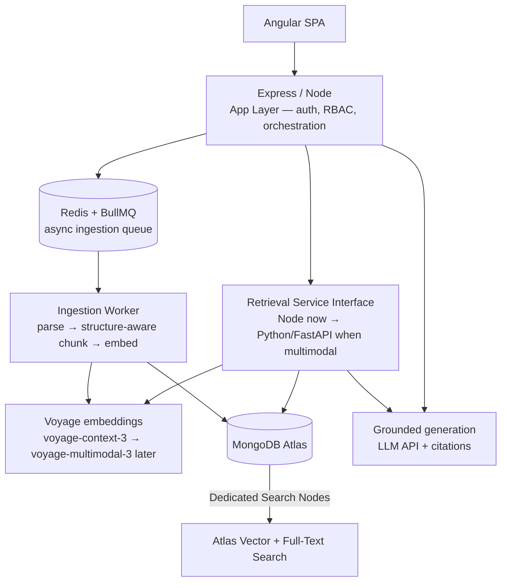

# Scalable Multi-Tenant RAG System — Final Architecture Blueprint

**Constraint (locked):** MongoDB is the system of record. The whole stack is MEAN, so the RAG system lives **inside MongoDB Atlas** — no second database introduced. This is Track C / Option 3 from the architecture doc, now engineered for scale.

**Targets this design must hit:**
- Many tenants using it **continuously at high concurrency**.
- **High-quality embeddings** — tenants will push large volumes of SOPs through it for retrieval.
- A **clean seam to add multimodal / multimedia later** without re-architecting.

---

## 1. The decision that makes MongoDB the *right* call, not just the mandated one

MongoDB acquired **Voyage AI** (Feb 2025) and integrates Voyage's embedding + reranking models natively into Atlas. That single fact resolves all three targets at once:

- **Best-in-class embeddings** for technical/SOP content — Voyage models rank at/near the top for retrieval quality, which is exactly the "very good embeddings" requirement.
- **Native to the stack** — no external embedding vendor to secure, meter, or sync; it lives where the data lives.
- **Future multimodal is a model swap, not a re-architecture** — Voyage already ships `voyage-multimodal-3` (text + images in one embedding space). Adding multimedia later means pointing the ingestion service at the multimodal model, not rebuilding retrieval.

So the recommendation is: **MongoDB Atlas Vector Search as the single store, Voyage embeddings + reranker, with the app/retrieval boundary designed so a Python service can slot in when multimodal arrives.**

---

## 2. Architecture at a glance



**Key principle:** the App Layer never talks to the store directly for retrieval — it calls a **Retrieval Service interface**. Today that interface is implemented in Node (Pattern A). When multimodal lands, the same interface is re-implemented/fronted by a Python FastAPI service (Pattern B) and the app layer doesn't change. This one seam is what makes the future phase cheap.

---

## 3. Data model (single Atlas cluster)

Everything lives in Atlas under one security model. Core collections:

| Collection | Purpose | Key fields |
|---|---|---|
| `chunks` | Retrievable units (the vector store) | `embedding[]`, `text`, `tenant_id`, `sop_id`, `section_path`, `question`, `answer/verdict`, `site`, `vendor`, `po`, `date`, `acl[]`, **`modality`**, `embed_model`, `embed_version` |
| `documents` | Source SOPs / reports (parent records) | `tenant_id`, `type`, `title`, `status`, `attachments[]`, hierarchy tree |
| `users` / `roles` | Auth + RBAC entitlements | `tenant_id`, role, site/vendor scope |
| `audit` | Query + access log (compliance) | `tenant_id`, user, query, retrieved chunk ids, timestamp |

**Non-negotiable design rules (these are the expensive-to-change decisions):**
1. **`tenant_id` on every single document, from day one** — even with one tenant. This is the difference between hard isolation later being a config change vs. a full re-ingestion.
2. **`modality` field on every chunk** (`"text"` now). Multimodal chunks (`"image"`, `"video_frame"`, `"transcript"`) drop into the *same* collection later and unify at retrieval by default.
3. **`embed_model` + `embed_version` on every chunk** — embeddings are versioned so a model upgrade is a controlled re-embed, not a mystery.

---

## 4. Embeddings & chunking (the retrieval-quality core)

- **Model:** Voyage `voyage-context-3` (contextualized chunk embeddings — it embeds each chunk *with awareness of its surrounding document context*, which is ideal for hierarchical SOPs where a bare "Not OK" line is meaningless without its section). Future: swap to `voyage-multimodal-3` for images through the same provider/interface.
- **Reranking:** add Voyage `rerank-2` as a second stage on top of hybrid retrieval — biggest single lever for precision when many SOPs are in play.
- **Chunking:** structure-aware, preserving `Section → Question → Answer` hierarchy. Store the hierarchy path in `section_path`. Use small precise chunks for matching + pull the parent section for generation context (parent-child retrieval).
- **Provider abstraction:** wrap embeddings behind an `EmbeddingProvider` interface so the model is swappable; but treat re-embedding as a versioned migration (see rule 3 above).

---

## 5. Ingestion pipeline (built for volume)

Runs as **async jobs, decoupled from retrieval** — critical so heavy SOP ingestion never contends with interactive queries:

```
Upload → queue (BullMQ/Redis) → worker: parse → structure-aware chunk
       → tag metadata (tenant_id, section_path, verdict, acl, modality)
       → embed (Voyage) → write chunks + document to Atlas (single transaction)
```

- Ingestion scales horizontally by adding workers, independently of the query tier.
- The parse→chunk→tag stage is **modality-agnostic by contract**, so adding an image/video branch later is an addition, not a rewrite.

---

## 6. Retrieval pipeline

1. **Resolve tenant + ACL** in middleware → inject `tenant_id` + entitlement filters into the query. *Never* rely on app code alone for the filter — it goes into the Atlas query itself.
2. **Hybrid search** — Atlas `$vectorSearch` (Voyage dense) + `$search` (BM25 full-text) fused via **`$rankFusion`**, with filters applied *at index time* (pre-filtered HNSW traversal, not a slow downstream `$match`).
3. **Rerank** top-K with Voyage `rerank-2`.
4. **Exact questions** ("how many lots rejected by vendor X") → aggregation-pipeline path for auditable counts, bypassing vector search.
5. **Grounded generation** with citations back to `sop_id` + `section_path`.

---

## 7. Multi-tenancy & concurrency (the scale story)

**Tenancy — phased, but reserved from day one:**
- **Phase 1 (now):** Model 1 — single cluster, `tenant_id` denormalized on every doc, injected into every query at index time. This is MongoDB's own recommended multi-tenant pattern and maps perfectly to Atlas Vector Search filtering.
- **Phase 2 (at scale / enterprise contracts):** Model 3 — promote heavy or hard-isolation tenants to **database-per-tenant**, fronted by a tenant-routing layer in the app. Because tenancy was abstracted in middleware from day one, this is a routing change, not a rewrite.

**Concurrency / continuous high load:**
- **Atlas Dedicated Search Nodes** — run vector/hybrid search on separate nodes from the operational database. This is the single most important lever for "many tenants, continuously, high concurrency": search load can't starve app writes, and search scales independently.
- **Stateless Node app tier** behind a load balancer → horizontal scale.
- **Shard by `tenant_id`** when the corpus grows large.
- **Redis cache** for hot queries / repeated embeddings.
- **Per-tenant rate limiting + token metering** at the app layer (fair use + cost control).
- Connection pooling; ingestion queue backpressure so ingestion spikes never degrade query latency.

---

## 8. The future multimodal seam (why later is easy)

Everything above is arranged so that adding multimedia is *additive*:

| Concern | Reserved now | Added later |
|---|---|---|
| Storage | `modality` field on every chunk | image/video/transcript chunks in same collection |
| Embeddings | Voyage provider abstraction | swap to `voyage-multimodal-3` (same vendor, same stack) |
| Compute | Retrieval Service *interface* | Python/FastAPI service behind it for keyframing, OCR, transcription |
| Retrieval | hybrid + filters already modality-blind | queries span text + media with no query rewrite |
| App layer | calls the interface, not the store | unchanged |

No part of the base has to be torn up to get there.

---

## 9. Build phases

| Phase | Scope | Outcome |
|---|---|---|
| **1 — Foundation** | Atlas cluster + `chunks`/`documents` schema with `tenant_id`, `modality`, `embed_version` reserved; ingestion queue; Voyage embeddings; hybrid retrieval + rerank; RBAC (Model 1); citations | Working multi-tenant text RAG over SOPs |
| **2 — Scale hardening** | Dedicated Search Nodes; caching; rate limiting/metering; sharding; audit logging | Production concurrency + continuous use |
| **3 — Isolation** | Model 3 hard tenant isolation for enterprise contracts | Contract/audit-grade multi-tenancy |
| **4 — Multimodal** | Python service behind the retrieval interface; `voyage-multimodal-3`; media ingestion | Images/video/transcripts unified into the same retrieval |

---

## 10. Open items to confirm with the client

1. **Embedding vendor:** OK to standardize on **Voyage (native to Atlas)**? It's the cleanest path and the multimodal future-proofing — but confirm data-residency/compliance is satisfied by their Atlas region.
2. **Isolation timing:** when does true multi-org hard isolation (Model 3) become contractual? Decides how soon Phase 3 lands.
3. **Expected volume & concurrency numbers** (tenants, docs/tenant, queries/sec at peak) → sizes Search Nodes and sharding.
4. **LLM for generation** — which provider/model, and is it hosted in a region their compliance allows?
5. **SOP formats** — are incoming SOPs consistently structured, or mixed layouts/scanned PDFs (affects parser investment)?
6. **Atlas tier** — are they on a tier that supports Dedicated Search Nodes, or does that need an upgrade before Phase 2?
